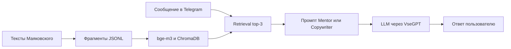

# MayakBot — два Telegram-бота с общим RAG-пайплайном

Мотивационные ответы и рекламные слоганы в стилистике Маяковского.
Контекст извлекается из корпуса произведений: `BAAI/bge-m3` → ChromaDB →
три релевантных фрагмента → prompt → LLM через VseGPT.

**Статус:** самостоятельный pet-проект для практики RAG и интеграции LLM.
**Мой вклад:** парсинг корпуса, подготовка фрагментов и индекса, retrieval,
промпты двух сценариев, Telegram-боты и Docker Compose.

**Стек:** Python 3.12+, aiogram 3, LangChain, ChromaDB, Sentence Transformers,
OpenAI-совместимый API, Docker Compose, uv.

## Как устроено



| Где смотреть | Что реализовано |
| --- | --- |
| [src/rag/chain.py](src/rag/chain.py) | retrieval, контекст, промпты и вызов LLM |
| [src/rag/build_index.py](src/rag/build_index.py) | локальная сборка Chroma-индекса из JSONL |
| [src/parser/main.py](src/parser/main.py) | сбор и разбиение произведений на фрагменты |
| [src/bots/](src/bots/) | два Telegram-сценария, обработчики и polling |
| [compose.yml](compose.yml) | отдельные процессы Mentor и Copywriter |

## Пример работы (Mayak Mentor)


## Запуск

Ключи двух ботов и доступ к VseGPT нужны для работы с Telegram и LLM.
Корпус и Chroma-индекс не входят в Git; их нужно подготовить до запуска ботов.

```bash
git clone https://github.com/Ruzik707/MayakBot.git
cd MayakBot
uv sync
cp .env.example .env
```

Заполните `MAYAKMENTOR_TOKEN`, `MAYAKCOPYWRITER_TOKEN`, `VSEGPT_API_KEY` в `.env`.
Затем из корня проекта:

```bash
# Получить data/mayakovsky-corpus.jsonl или положить свой корпус этого формата
uv run python -m src.parser.main

# Построить индекс; при первом запуске загрузятся веса bge-m3
uv run python -m src.rag.build_index
# При наличии CUDA: добавить --device cuda

# Запустить обоих ботов
# Индекс из data/ будет включён в локальную сборку образа
docker compose up --build -d
```

Для локального запуска без Docker — в двух терминалах:

```bash
uv run python -m src.bots.MayakMentor
uv run python -m src.bots.MayakCopywriter
```

Сообщения пользователей и найденный контекст передаются провайдеру LLM.
Синхронный RAG-вызов вынесен из event loop через `asyncio.to_thread`.

## Проверка подготовки индекса

```bash
python -m unittest discover -s tests -v
```

Проверяются JSONL, метаданные и повторяющиеся ID; веса модели не загружаются.

## Ограничения

- RAG здесь задаёт литературный контекст; количественная оценка стиля и качества
  ответов не проводилась. Снижение галлюцинаций экспериментально не измерялось.
- Парсер зависит от структуры culture.ru. Готовый индекс без корпуса не восстановить.
- Каждый процесс загружает свою embedding-модель; первое включение требует времени
  и доступа к хранилищу моделей.
- Доступность ответов зависит от Telegram и LLM-провайдера; общего лимитера запросов
  и долговременной истории диалогов нет.

Исторический Colab-эксперимент сохранён в [ноутбуке](notebooks/build_vector_db.ipynb).
Для локального запуска используйте CLI выше: он нормализует метаданные под Chroma.
